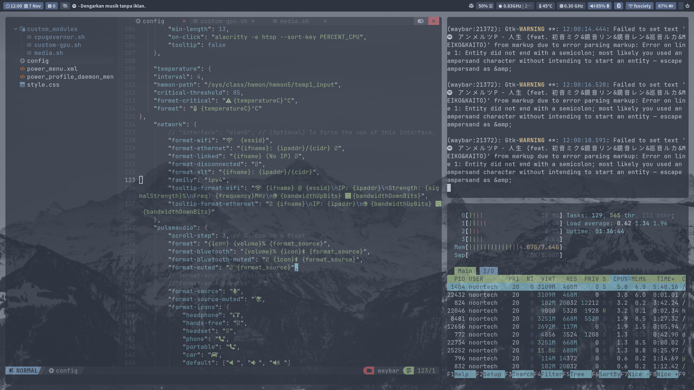

# ❄️ MangoWM — Nord Theme

<p align="center">
  
  
  
  
</p>

<h3 align="center">A calm, minimal, and cohesive Nordic desktop experience.</h3>

<p align="center">
  A personal MangoWM configuration built around the
  <strong>Nord color palette</strong>, designed for simplicity,
  consistency, and a distraction-free workflow.
</p>

---

## 01 — Preview

<p align="center">
  
</p>

<p align="center">
  <sub>Nord-inspired desktop environment · MangoWM · Wayland</sub>
</p>

> Replace the preview image with your actual desktop screenshot.

---

## 02 — Philosophy

This configuration is built around one simple idea:

**Less visual noise. More focus.**

Inspired by the Nord color palette, every component follows a consistent visual language — from terminal to application launcher.

No unnecessary decorations. No excessive colors. Just a clean desktop environment that feels natural to work with.

---

## 03 — Color Palette

| Color | Hex | Usage |
|:--|:--|:--|
| Polar Night | `#2E3440` | Background |
| Polar Night | `#3B4252` | Secondary background |
| Polar Night | `#434C5E` | UI elements |
| Polar Night | `#4C566A` | Muted elements |
| Snow Storm | `#D8DEE9` | Foreground |
| Snow Storm | `#E5E9F0` | Secondary text |
| Snow Storm | `#ECEFF4` | Primary text |
| Frost | `#8FBCBB` | Accent |
| Frost | `#88C0D0` | Primary accent |
| Frost | `#81A1C1` | Secondary accent |
| Frost | `#5E81AC` | Deep accent |

---

## 04 — Components

| Component | Description |
|:--|:--|
| MangoWM | Wayland compositor |
| Waybar | Status bar and system information |
| Wofi | Application launcher |
| Alacritty | GPU-accelerated terminal emulator |
| Nord Theme | Unified color scheme |

### Visual Direction

- Consistent Nord color scheme.
- Minimal window decorations.
- Clean and readable typography.
- Subtle visual effects.
- Keyboard-driven workflow.
- Lightweight desktop experience.

---

## 05 — Requirements

Before using this configuration, make sure you have:

- Linux distribution with Wayland support.
- MangoWM installed.
- Waybar.
- Wofi.
- Alacritty.
- JetBrainsMono Nerd Font.
- Required utilities used by the configuration scripts.

Some dependencies may vary depending on your Linux distribution.

---

## 06 — Installation

Clone the repository:

```bash
git clone https://github.com/YOUR_USERNAME/YOUR_REPOSITORY.git
cd YOUR_REPOSITORY
```

Review the configuration files before applying them.

Back up your existing configuration:

```bash
mkdir -p ~/.config/backup
cp -r ~/.config/mango ~/.config/backup/ 2>/dev/null
```

Copy the desired configurations into their respective directories.

> Installation paths may need adjustment depending on your repository structure.

---

## 07 — Repository Structure

```text
.
├── mango/
│   ├── config.conf
│   └── startup.sh
│
├── waybar/
│   ├── config
│   └── style.css
│
├── wofi/
│   └── style.css
│
├── alacritty/
│   └── alacritty.toml
│
└── assets/
    └── screenshot.png
```

*Example structure — adjust to match the actual repository.*

---

## 08 — Credits & Acknowledgements

This setup wouldn't exist without the amazing work of:

- [MangoWM](https://github.com/DreamMaoMao/mango) — Wayland compositor.
- [Nord Theme](https://www.nordtheme.com/) — Beautiful Arctic-inspired color palette.
- [Waybar](https://github.com/Alexays/Waybar) — Highly customizable status bar.
- [Wofi](https://hg.sr.ht/~scoopta/wofi) — Application launcher.
- [Alacritty](https://github.com/alacritty/alacritty) — GPU-accelerated terminal emulator.

All credits belong to their respective developers and maintainers.

---

<p align="center">
  <strong>Made with ❄️ and simplicity.</strong>
  <br/>
  <sub>A personal Linux desktop configuration by Noor.</sub>
  <br/><br/>
  <code>Nord · MangoWM · Wayland</code>
</p>
